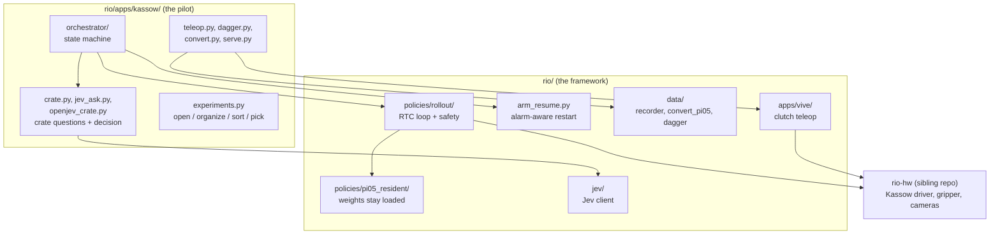
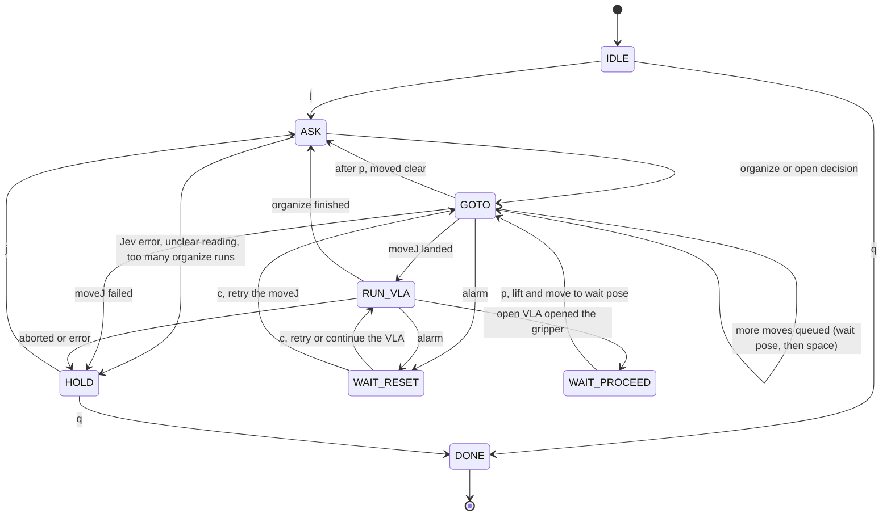

# Architecture: Kassow crate-loading pilot

Map from the pilot case study (Juárez, work in progress) to the code. Start here, then follow the links.

## Layers



## Orchestrator states

A state machine is a directed graph: states are nodes, key presses and action results are edges.



## Case study term to code

| Case study | Code | Notes |
|---|---|---|
| Orchestrator ("task graph") | `rio/apps/kassow/orchestrator/` | A state machine, drawn as a graph above: `IDLE, ASK, GOTO, RUN_VLA, WAIT_PROCEED, WAIT_RESET, HOLD, DONE` (`machine.py`). Every action is injected from `actions.py` and `skills.py`; `run.py` wires it up. |
| Robot skills (Move To, Pick, Place) | `rio/apps/kassow/skills.py` (`KassowSkills`, `DrySkills`) | `move_to` (`moveJ` to a saved pose), `lift`, `pick` (close, true only if an object blocks the jaws), `place` (open). The orchestrator calls `move_to` and `lift`; no workflow step calls `pick` or `place` yet (insertion is manual). |
| VLAs `open`, `organize`, `sort` | `experiments.py` (registry), `policy_cfgs/` | One experiment selects model, instruction, camera, home poses and data folder. `sort` is not part of the orchestrator. |
| Policy execution, RTC, 20 Hz | `rio/policies/rollout/`, `rio/policies/rtc.py`, `rio/policies/pi05.py` | Entry point `uv run -m rio.apps.kassow.serve`. |
| Resident policy process | `rio/policies/pi05_resident/` | Keeps weights loaded between rollouts. |
| Jev / OpenJev visual layer | `rio/jev/client.py` (transport), `rio/apps/kassow/crate.py` (questions, thresholds, Bayes prior), `jev_ask.py`, `openjev_crate.py` | "Jev" is the client and API, "OpenJev" the local helper (`scripts/openjev_serve.sh`). |
| Alarm-aware restart | `rio/arm_resume.py`, `Orchestrator._alarm` / `_reset` | Remembers the interrupted phase and decides retry or continue from the measured pose. |
| Teleop (clutch, scaling, episode keys) | `rio/apps/vive/`, `rio/apps/kassow/teleop.py` | |
| HG-DAgger corrections | `rio/apps/kassow/dagger.py`, `rio/data/dagger.py` | Takeover and recording; effect on success is unmeasured. |
| Data conversion to LeRobot | `rio/data/convert_pi05/`, `rio/apps/kassow/convert.py` | |
| Bayes prior fusion | `bayes_posterior`, `organized_prior` in `rio/apps/kassow/crate.py` | Prototype. |

Not in the code: the second Kassow arm, the physical safety concept, a System 1/System 2 task-graph generator, serial-number reading.
The gripper is driven as `AgGripper` (AG95).

## Reading order

1. This page, then [Kassow π₀.₅ pipeline](workflow/pi05_kassow_pipeline.md) for recording, conversion, training, serving and evaluation.
2. `rio/apps/kassow/orchestrator/machine.py`, then `actions.py` and `run.py`.
3. `rio/apps/kassow/crate.py` for what is asked from Jev and how the answer becomes a decision.
4. `rio/policies/rollout/` for the policy loop and its safety checks.
5. `rio/_tests/`: `test_orchestrator_kassow.py`, `test_arm_resume.py`, `test_jev_client.py`, `test_dagger.py`, `test_pi05.py` show intended behaviour without hardware.

## Try it without a robot

```bash
uv sync --frozen --python 3.12 --group dev
make test
uv run -m rio.apps.kassow.orchestrator --dry-run --board   # asks Jev, only prints moves and VLA steps
```

The dry run needs a Jev camera and either `TYPESAFE_API_KEY` or the local OpenJev helper. Hardware, GPU and a sibling `../rio-hw` checkout are required for anything else.

## Where outputs go

Recordings, home poses, diagnostics, DAgger rounds and orchestrator probes are written to the experiments workspace:
`$RIO_EXPERIMENTS_DIR`, else `experiments/` in the working directory. It is git-ignored; no pilot data ships with the repo.

Machine-specific values (controller IP, gripper port, camera serials) are in `rio/apps/kassow/hardware.py` and can be overridden with
`RIO_KASSOW_IP`, `RIO_GRIPPER_PORT`, `RIO_WRIST_SERIAL`, `RIO_OVERVIEW_SERIAL` and `RIO_JEV_SERIAL`.

## Same name, different job

| Name | Where | Role |
|---|---|---|
| `serve.py` | `rio/policies/serve.py` | Generic serve CLI and resident lifecycle for any policy config. |
| `serve.py` | `rio/apps/kassow/serve.py` | Binds the Kassow policy configs and DAgger takeover to the generic one. |
| `policy_cfgs/` | `examples/policy_cfgs/` | Generic policies: OpenPI π₀.₅ (DROID style), SmolVLA. |
| `policy_cfgs/` | `rio/apps/kassow/policy_cfgs/` | Kassow π₀.₅ and DAgger configs. |
| Jev | `rio/jev/` | Transport only: request, reply validation, credentials. |
| Jev | `rio/apps/kassow/crate.py` | The crate questions and how answers become a decision. |
| Jev | `jev_ask.py`, `openjev_crate.py` | Command-line tools to ask Jev or a local OpenJev helper. |

## Security notes

- No credential is stored in the repo. `TYPESAFE_API_KEY` and the optional `SHIM_TOKEN` are read from the environment.
- `rio.jev` only opens `http(s)` URLs and refuses to send a credential over plain HTTP to any host other than loopback.
- With the hosted backend, crate photos leave the network. Use the local OpenJev helper when images must stay on premises.
- The demo page binds to `127.0.0.1` and serves three fixed paths.
- The resident policy process listens on an owner-only socket and authenticates each connection with a random key kept in an owner-only runtime directory. Messages after that are pickled, so only run it under a user you trust.
