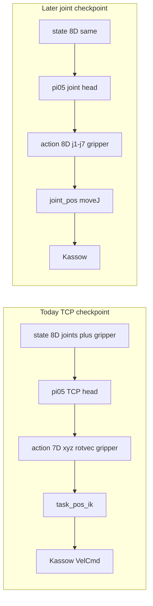

# π₀.₅ joint-space concept (Kassow)

**Status:** convert + joint serve are implemented. `ckpts/pi05` is still TCP-only. Train a new joint checkpoint, then use `POLICY=Pi05LerobotJointCfg`.

This page answers: can the models we already trained drive the Kassow in **joint space**? No. How do we train and serve joints from the same demos?

Related: [cluster training brief](pi05_kassow_cluster_training.md) (TCP contract), [deploy](deploy.md) (live serve).

---

## Verdict

`ckpts/pi05` outputs **absolute TCP**: `x, y, z, rx, ry, rz, gripper`. Those seven numbers are **not** joint angles. Sending them to `moveJ` would be wrong and unsafe.

Joint control needs a **newly trained** policy whose `action` is joints. The 180 demos already store the seven Kassow angles. Vive teleop and the 7th axis do **not** have to change for that dataset.



---

## 1. What the trained model actually outputs

`ckpts/pi05/config.json`:

| Field | Value |
|---|---|
| `output_features.action.shape` | 7 |
| `action_feature_names` | `x, y, z, rx, ry, rz, gripper` |
| `use_relative_actions` | `false` |
| `observation.state` | 8 (`j1…j7, gripper`) |

Serve follows that contract:

- [`rio/policies/pi05.py`](../../rio/policies/pi05.py) — after LeRobot postprocess, slice `[:, :7]`, fold `principal_rotvec` on indices 3:6, snap the gripper. The class docstring is explicit: emit `(chunk, 7)` **TCP + gripper**.
- [`examples/policy_cfgs/pi05_lerobot.py`](../../examples/policy_cfgs/pi05_lerobot.py) — `action_space=task_pos`, `arm_cfg.robot_controller=task_pos_ik`.

The 8D state already contains joints. That only means the network **sees** joint proprio. It still **commands** TCP. Seeing joints is not the same as outputting joints.

---

## 2. Why we cannot just send “joints”

The seven action slots are metres and axis-angle, not radians. QUANTILES were fit on TCP stats (workspace `x` is about −0.68…−0.04 m). Decoding that head as `q` is meaningless: a “0.3” in slot 0 is 30 cm of `x`, not 0.3 rad on `j1`.

A–C (offline ADE ~12 cm, live leftover spans ~6–9 cm) showed the TCP plan is short and off. D showed the **same** Kassow IK can track a ground-truth TCP episode. Switching dispatch from `task_pos_ik` to `moveJ` does not change what the head predicts. It only changes the units the arm would misread.

Do not point `Pi05LerobotCfg` at `joint_pos` / `moveJ` with `ckpts/pi05`.

---

## 3. What is already in the demos (no new teleop)

Robodm `.vla` already has both streams ([`rio/data/convert_pi05.py`](../../rio/data/convert_pi05.py)):

| Key | Role today |
|---|---|
| `observation/proprio_joints` | 7 angles → dataset `observation.state` (plus gripper) |
| `action` | TCP xyz + rotvec + gripper → dataset `action` |

Vive still gives a 6D TCP. `task_pos_ik` writes the seven angles. A joint dataset would set `action = joints + gripper` (**8D**), keep idle-trim on TCP motion, and skip rotvec unwrap.

π₀.₅ pads actions to `max_action_dim=32`. Eight dimensions are fine. Do **not** lock joint 7 just to make this dataset: lock only later if joint ADE on these 180 episodes is large because the null space wandered between takes.

`data/lerobot/kassow_pi05` stays the TCP set. A joint folder would be a **new** root, not an overwrite.

---

## 4. Parallel inference mode (implemented)

Two checkpoints, two dataset roots, two policy configs. One process, one arm.

| | Cartesian (exists) | Joint (later) |
|---|---|---|
| Config | `Pi05LerobotCfg` | `Pi05LerobotJointCfg` |
| Checkpoint | `ckpts/pi05` (TCP) | `ckpts/pi05_joints` (train on `kassow_pi05_joints`) |
| `action` | 7D TCP + gripper | 8D `j1…j7, gripper` |
| `action_space` | `task_pos` | `joint_pos` |
| Controller | `task_pos_ik` | `joint_pos` (`moveJ`) |
| Postprocess | `principal_rotvec` on 3:6 | **no** rotvec fold |

Switch with `POLICY=` and `--policy-path`. Do not run both networks at once.

**Guard:** joint mode loads only if checkpoint `action_feature_names` are joints (`j1…j7` or equivalent 8D). Reject a TCP checkpoint (`x, y, z, rx, ry, rz, gripper`).

**Before live `moveJ`:** repeat the offline test (A) in joint space — ADE in rad, plus FK TCP error against the demo TCP. Live only if those numbers are small.

Hardware dispatch for `JOINT_POS` already exists on [`SingleArm`](../../rio/embodiments/single_arm.py) / [`BaseEmbodiment._dispatch_arm`](../../rio/embodiments/base.py) (`moveJ`).

---

## 5. What we still do not do

- Do not retarget `ckpts/pi05` at `moveJ`.
- Do not lock j7 or recollect demos for this dataset.
- Do not overwrite `data/lerobot/kassow_pi05`.

Convert (new folder, never overwrite `kassow_pi05`):

```bash
uv run -m examples.data.convert_to_lerobot_pi05 \
  --input data/kassow_vive_gripper \
  --output data/lerobot/kassow_pi05_joints \
  --repo-id local/kassow_pi05_joints \
  --tasks data/kassow_vive_gripper/tasks.yaml \
  --action-space joints
```

`action[t, :7] = q[t+1]` (last frame repeats `q[-1]`); gripper is the teleop command at `t`.

Serve after the cluster `pretrained_model/` is copied to `ckpts/pi05_joints/`:

```bash
POLICY=Pi05LerobotJointCfg uv run --group pi --no-group docs -m examples.policy_inference \
  --policy-path ckpts/pi05_joints \
  --instruction "pick up the blue cylinder and place it on the red plate" \
  --policy-cfg.device cuda:1
```

A TCP checkpoint in this config raises. See [cluster brief §11](pi05_kassow_cluster_training.md) for `lerobot-train`.
